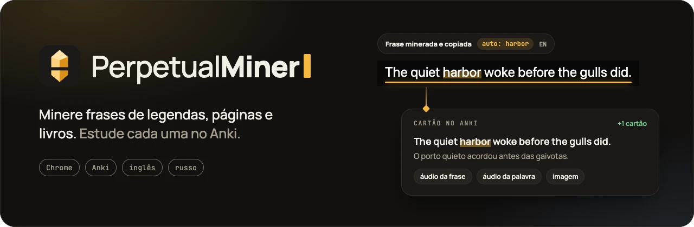
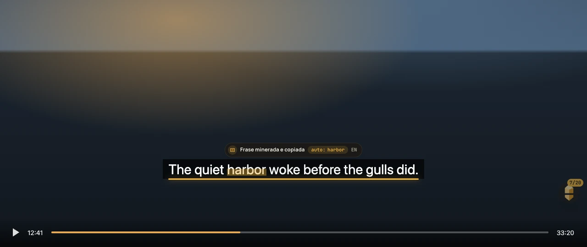
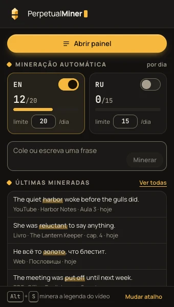
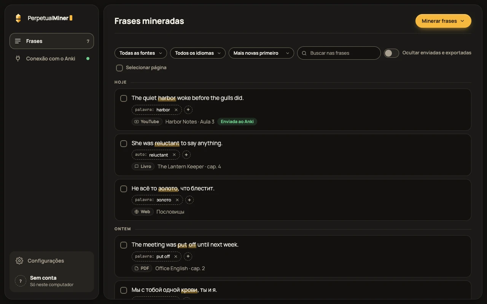
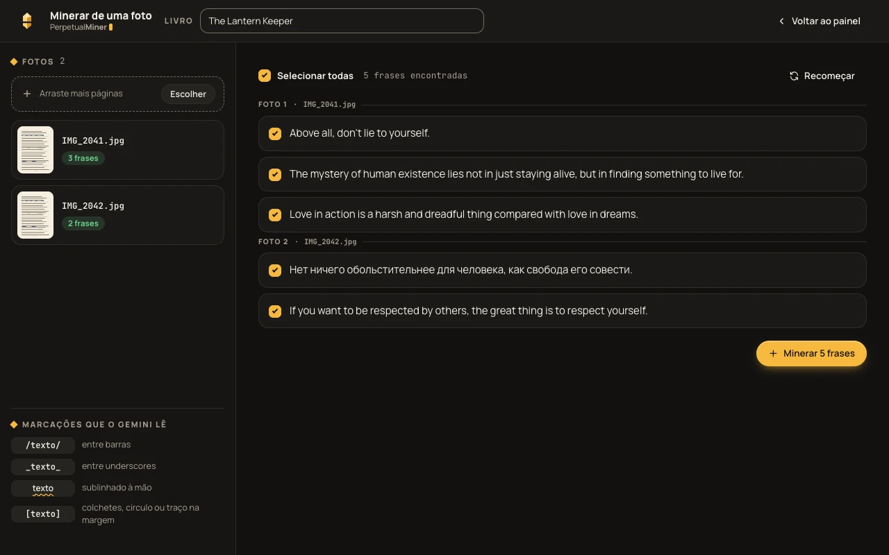
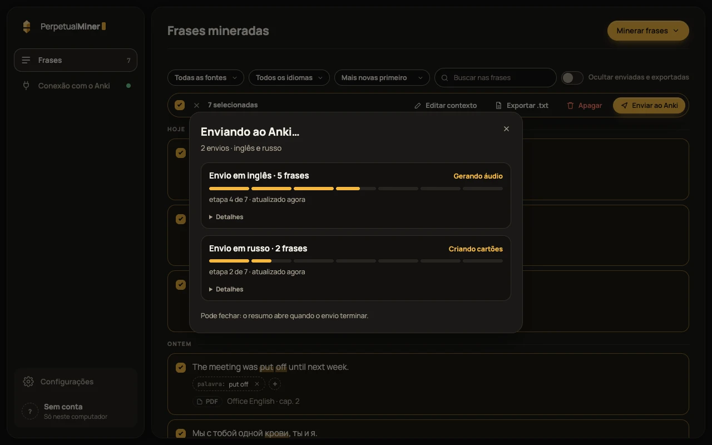
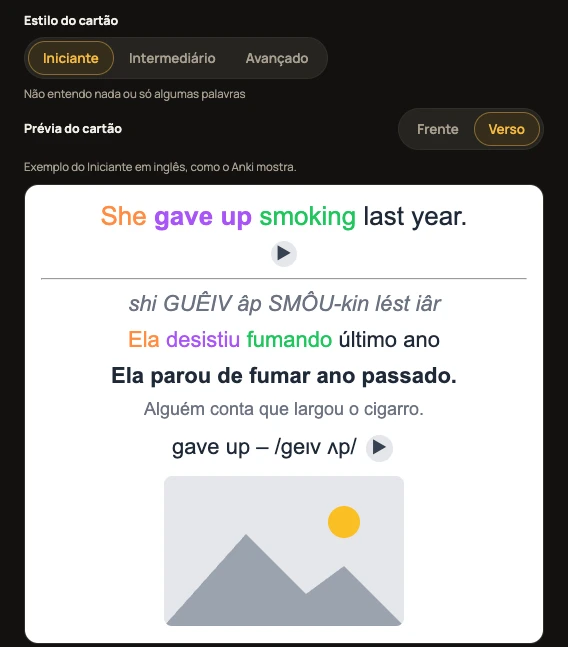
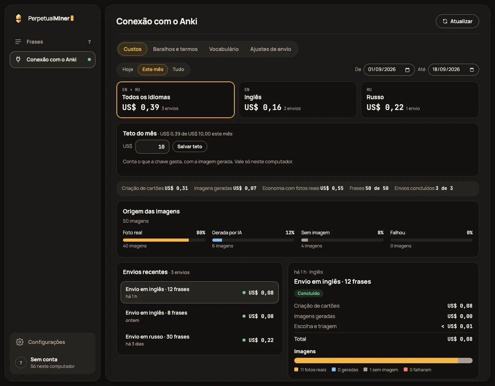

<p align="center">
  
</p>

# PerpetualMiner

O PerpetualMiner é uma extensão do Chrome para quem estuda inglês ou russo. Você minera uma frase da legenda de um vídeo, de uma página ou da foto de um livro. A extensão guarda a frase num histórico e a envia ao Anki como cartão, com áudio e imagem.

Minerar, aqui, é pôr uma frase no histórico. Os outros termos do projeto estão em [`glossary.md`](glossary.md).

## Para quem é

Para quem aprende inglês ou russo vendo vídeo e lendo, e revisa no Anki. A tela é em português do Brasil.

A extensão só conhece esses dois idiomas. Texto com letra cirílica é russo, e todo o resto ela trata como inglês.

## O que ele faz

### Minera a legenda com um atalho



Com o vídeo aberto, aperte `Alt+S` ou clique no botão que a extensão põe sobre o player. A fala que está na tela entra no histórico com o nome do vídeo e do episódio, e já fica copiada.

A extensão tem leitura própria para YouTube, Netflix, Prime Video, Max e Kinopoisk. Em outro player ela procura a legenda pelos seletores comuns, e pode não achar.

Fora do vídeo, selecione um texto em qualquer página ou PDF, clique com o botão direito e escolha Minerar com PerpetualMiner. Em Configurações › Atalhos você grava uma tecla ou um botão do mouse para isso.

### Minera sozinho enquanto o vídeo roda



A Mineração automática vem desligada. Ligada para um idioma, ela minera a linha de legenda que tem exatamente uma palavra nova para você. As palavras que o seu baralho do Anki já tem não contam como novas.

Ela para no limite do dia. O limite vem em 20 e vai de 1 a 100.

O popup abre pelo ícone da extensão. Ele traz esses controles, as cinco últimas frases e um campo para colar uma frase à mão.

<br clear="right">

### Guarda as frases no painel



O painel lista as frases por dia, com a fonte, o título e o episódio ou capítulo. Você busca, filtra por fonte e por idioma, corrige o texto e escolhe a Palavra, que é a palavra que o cartão vai ensinar. Uma frase com duas Palavras vira dois cartões.

O botão Minerar frases aceita texto colado, um arquivo .txt e fotos. Exportar .txt grava as frases selecionadas num arquivo que o painel lê de volta.

As frases ficam no seu navegador. Se você entrar com o Google, elas também vão para a sua conta no Firestore e aparecem nos seus outros computadores. O PerpetualMiner não tem servidor próprio nem análise de uso. A [política de privacidade](https://perpetualminer.com/privacidade/) diz o que vai para onde.

### Lê o que você marcou num livro de papel



Marque o trecho no livro com `/barras/`, `_underscores_`, sublinhado, colchetes, círculo ou traço na margem. Fotografe a página e solte a foto em Minerar de uma foto. O Gemini lê só o que você marcou, com a sua chave de API, e você escolhe quais frases minerar.

### Envia ao Anki como cartão



Selecione as frases e clique em Enviar ao Anki. Quem faz o cartão é a Conexão com o Anki, um complemento que roda dentro do Anki do seu computador e atende a extensão em `127.0.0.1:8766`. Para cada Palavra ela faz quatro coisas:

1. Escreve o texto do cartão com um modelo da OpenAI. Quem paga é a sua chave de API ou o seu plano do ChatGPT Plus ou Pro.
2. Gera o áudio da frase e o da Palavra com a voz do Google Tradutor.
3. Busca uma foto no Openverse. Sem foto boa, gera a imagem por IA, e isso tem custo.
4. Grava a nota no baralho do idioma.

Frases de dois idiomas viram dois envios. Você pode fechar o painel, porque o envio continua dentro do Anki e o resumo abre quando ele termina. Enviar a mesma frase de novo não duplica o cartão.

### Monta o cartão no seu nível



Cada idioma tem três níveis de cartão. O Iniciante traz a pronúncia escrita em português, a tradução palavra por palavra com as cores ligando cada par, a tradução natural e o contexto da cena. O Intermediário e o Avançado trocam a tradução por uma definição e outro exemplo.

A frente também muda. São seis: Frase com áudio, Ouvir primeiro, Lacuna, Produção, Ditado e Criação.

Ajustes de envio mostra a prévia do cartão antes de você salvar. A imagem desta seção é essa prévia, e o desenho cinza marca onde a imagem do cartão entra. Quem já tem um tipo de nota no Anki pode usá-lo no lugar do nosso.

<br clear="right">

### Mostra quanto cada envio custou



A aba Custos soma o que a sua chave gastou, por envio e por idioma. O teto do mês vem em US$ 10. A 80% o painel avisa, e a 100% o envio pausa antes do próximo cartão.

As telas acima são da extensão rodando no Chromium, num perfil descartável, com frases de exemplo. O Anki, o Gemini e o Google eram os substitutos da suíte de testes.

## Requisitos

Só o Chrome é obrigatório. O resto entra quando você liga cada recurso.

| Para | Você precisa de |
|---|---|
| Minerar e usar o painel | Chrome 110 ou mais novo. O Opera carrega a mesma pasta. |
| Enviar ao Anki | Anki 2.1.50 ou mais novo, e uma chave de API da OpenAI ou uma conta do ChatGPT Plus ou Pro |
| Minerar de uma foto | Uma chave de API do Gemini |
| Ver as frases em outro computador | Uma conta Google |

A Conexão com o Anki abre o Anki fechado só no Mac e no Windows.

## Instalar

A Chrome Web Store ainda não lista a extensão. Hoje você a carrega da pasta do repositório.

```bash
git clone https://github.com/vinicius928e8r84/PerpetualMiner.git
```

1. Abra `chrome://extensions` e ligue o Modo do desenvolvedor.
2. Clique em Carregar sem compactação e escolha a pasta clonada, a que tem o `manifest.json`.
3. A aba de Boas-vindas abre sozinha. Ela tem nove passos, e os opcionais dá para pular.

Não há build. A pasta do repositório é a extensão. Carregada assim, ela relê os próprios arquivos a cada minuto e se recarrega depois de um `git pull`. O guia [`docs/instalar-extensao.md`](docs/instalar-extensao.md) ensina a agendar o pull no Mac, no WSL e no Windows.

### A Conexão com o Anki

1. No painel, abra Conexão com o Anki e clique em Baixar a Conexão com o Anki.
2. Abra o arquivo baixado. O Anki pergunta se quer instalar.
3. Reinicie o Anki.
4. De volta ao painel, clique em Conectar e digite o código que o Anki mostrar.

Se o arquivo não abrir, vá no Anki em Ferramentas › Extensões › Obter extensões e cole o código `1108882947`. A página dela no AnkiWeb é [ankiweb.net/shared/info/1108882947](https://ankiweb.net/shared/info/1108882947).

## Usar

1. Abra um vídeo com legenda em inglês ou russo e aperte `Alt+S`.
2. Clique no ícone da extensão e em Abrir painel.
3. Confira a Palavra de cada frase.
4. Selecione as frases e clique em Enviar ao Anki.

## Desenvolver

A extensão é JavaScript puro em Manifest V3. O complemento do Anki usa só a biblioteca padrão do Python e roda no 3.9 e no 3.13. O motor que escreve o cartão fica em `engine/` e tem as dependências em `engine/requirements.txt`.

| Caminho | O que tem |
|---|---|
| raiz | A extensão: `manifest.json`, `background.js`, `content.js`, `overlay.*`, `popup.*`, `painel/`, `bookreader.*` |
| `lib/` | Os módulos que as telas dividem |
| `veio/` | A identidade visual: tokens, componentes, fontes e ícones |
| `complemento/` | A Conexão com o Anki, o complemento que roda dentro do Anki |
| `engine/` | O motor que faz o texto, o áudio e a imagem do cartão |
| `e2e/` | Os testes de tela, com Playwright |
| `scripts/` | O executor dos testes, as regras de revisão e o empacotador |
| `docs/` | Arquitetura, armazenamento, design e os guias de instalação |

### Testes

Um comando roda cada grupo de testes, e é o mesmo que o CI chama. Os grupos estão em [`scripts/testes.json`](scripts/testes.json).

```bash
# os grupos e os arquivos de cada um
node scripts/testar.mjs --listar
# os testes rápidos, em Node
node scripts/testar.mjs node regras ferramentas
# o complemento do Anki, também com python3.13
PYTHON=python3.9 node scripts/testar.mjs complemento
# o motor, depois de pip install -r engine/requirements.txt
node scripts/testar.mjs engine
# as regras de revisão
node scripts/regras/verificar.js
```

Os testes de tela abrem a extensão num Chromium de verdade.

```bash
cd e2e
npm ci
npm run setup   # baixa o Chromium do Playwright
npm test
```

A suíte inteira demora, e o CI a divide em 8 fatias. Para rodar só uma área, da raiz:

```bash
node scripts/testar.mjs e2e -- popup --workers=2
```

[`docs/testes.md`](docs/testes.md) explica as fixtures e os substitutos do Anki, do Gemini e do Google.

### Contribuir

- Problemas e ideias vão nas [issues](https://github.com/vinicius928e8r84/PerpetualMiner/issues).
- [`CODING_STANDARDS.md`](CODING_STANDARDS.md) lista o que a revisão cobra. `node scripts/regras/verificar.js` confere a parte que um script enxerga.
- Comportamento novo da extensão ganha teste em `e2e/`.
- O corpo da PR segue [`.github/PULL_REQUEST_TEMPLATE.md`](.github/PULL_REQUEST_TEMPLATE.md). Confira com `node scripts/ci/corpo-da-pr.js <arquivo.md>` antes de abrir.

Agentes começam por [`AGENTS.md`](AGENTS.md). O papel de cada arquivo está em [`docs/arquivos/`](docs/arquivos/extensao.md), e o caminho dos dados em [`docs/arquitetura.md`](docs/arquitetura.md).

## Licença

[AGPL-3.0](LICENSE.md). As fontes Manrope e JetBrains Mono vêm no pacote sob a OFL, com as licenças em `veio/fontes/`.

## In English

PerpetualMiner is a Chrome extension for people learning English or Russian. It saves sentences from video captions, web pages and photos of book pages, then sends them to Anki as cards with audio and an image. The Anki side is an add-on, [AnkiWeb code 1108882947](https://ankiweb.net/shared/info/1108882947).

The interface is in Brazilian Portuguese only. The contributor docs for agents, [`AGENTS.md`](AGENTS.md) and [`CODING_STANDARDS.md`](CODING_STANDARDS.md), are in English.
